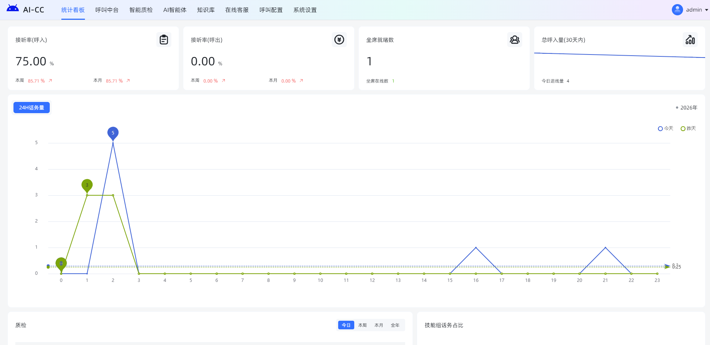

<h1 align="center">🧠 Ai Call Center</h1>

<p align="center">
  <b> Knowledge Brain for Java</b> —— 让 Java 团队零门槛拥有企业级 AI 大脑<br/>
  基于 <b>Java 21 + Spring Boot 3（虚拟线程）</b>构建的开箱即用、模型中立的 <b>RAG + LLM 工作流引擎</b><br/>
  <sub>智能客服 · 企业知识库 · 数据分析 · 学术研究与教育</sub>
</p>

<p align="center">
  <a href="https://www.gnu.org/licenses/gpl-3.0.html"></a>
  <a href="https://openjdk.org/projects/jdk/21/"></a>
  <a href="https://spring.io/projects/spring-boot"></a>
  <a href="https://github.com/langchain4j/langchain4j"></a>
</p>
<p align="center">
    <a href="#技术栈与关键组件">技术栈与关键组件</a> ·
    <a href="#documentation">Docs</a> ·
    <a href="https://voicestudio.sh/pro?utm_source=github&amp;utm_medium=readme&amp;utm_campaign=project">VoiceStudio Pro</a> ·
    <a href="https://app.voicestudio.sh/?utm_source=github&amp;utm_medium=readme&amp;utm_campaign=project">VoiceStudio Cloud</a>
</p>
<p align="center">
  [<a href="README.md">中文（简体）</a>] | [<a href="README.md">English</a>]
</p>

## ✨ 呼叫中心核心能力

| 能力                           | 说明                                                                                                            |
|:-----------------------------|:--------------------------------------------------------------------------------------------------------------|
| 🔍 知识库问答                     | 上传 PDF / Word / TXT / Markdown 等文档或自动爬取网页，自动完成分段 → 向量化 → 入库 → 构建 RAG，显著减少大模型幻觉；支持文档内图片融合向量化，实现图文混合检索          |
| 🧠 Advanced RAG / AgenticRAG | 向量、全文、混合多路召回 + Reranker 重排序；结合意图识别、条件分支，由智能体动态决策检索路径，支持多跳问答                                                   |
| ⚙️ 可视化IVR工作流               | 低代码编排 30+ 种节点：条件分支、循环、变量聚合、NL2SQL、表单、HTTP 请求、MCP 等，支持多轮与长期记忆                                                  |
| ⚙️ 可视化工单工作流               | 工作流引擎采用基于PVM（Process Virtual Machine）的架构模式，支持bpm协议中的多种节点功能，表结构简单明了，易于扩展及后期运维                                                |
| 🤝 多 Agent 协作                | 多角色智能体（数据分析师、代码审查员、客服专员…）并行 / 串行协同，任务自动拆解、分派与汇总，共享记忆总线                                                        |
| ⏰ 触发器                        | Cron 定时任务 + Webhook 事件回调，实现智能体与工具无人值守自动化（自动生成日报、CRM 线索触发画像分析等）                                                |
| 🌐 模型中立                      | 私有模型（Ollama / Xorbits Inference / LocalAI）与国内外公有模型：通义千问、DeepSeek、豆包、混元、GLM、Kimi、GPT、Claude、Gemini 等           |
| 🧩 无缝集成                      | RESTful API、iframe / Web SDK 嵌入组件、OpenAI 兼容对话接口、stream_http MCP 接入方式，5 分钟接入现有系统                               |
| 🎙️ 多模态                      | **多模态融合向量**：文档中文本与图片融合为统一向量，支持图文混合的跨模态检索（阿里云百炼 / 火山方舟视觉向量模型）；ASR 语音识别、TTS 语音合成、OCR 图像识别、Stable Diffusion 图像生成 |
| 🔒 权限与安全                     | 基于 Sa-Token 的细粒度权限（应用 / 知识库 / 工具 / 模型）、审计日志、groovy-sandbox 脚本沙箱                                               |


## 技术栈与关键组件

### 后端技术栈
- **框架**：Spring Boot 3.3.1、MyBatis-Plus、Spring Security、SA-TOKEN。
- **数据库**：MySQL（主库）、Pg vector(向量库)、qdrant（向量缓存）、Redis（缓存与会话）。
- **消息队列**：RabbitMQ（异步任务处理）。
- **通信协议**：SIP（FreeSWITCH）、MRCP V2（语音交互）。

### 核心组件
- **FreeSWITCH**：VoIP 核心引擎，处理媒体流与信令。
- **Kamailio**：SIP 代理服务器，实现负载均衡与安全防护。
- **ESL 客户端**：通过 Java Netty 实现与 FreeSWITCH 的交互。
  
### 系统架构

### 在线Demo
- 话务系统在线 Demo：http://118.195.135.225/ui     （自动登陆账号为普通用户权限）
- 工单系统在线 Demo：http://118.195.135.225/tk  （自动登陆账号为普通用户权限）

## 应用案例
- **产品演进** 本团队深耕呼叫中心行业经验15年，大模型呼叫中心迭代5年以上由早期智能客服项目，演进到以python为核心的大模型产品，于近期再次迭代到以java为主要架构的产品
- **客户行业** 分布于运营商，知名高校，水利，供暖集团

# 系统截图
<table>
  <tr>
    <td width="50%" valign="top">
      
      <br/>
      话务系统首页.
    </td>
    <td width="50%" valign="top">
      
      <br/>
      IVR工作流可视化编辑，及在线调试.
    </td>
  </tr>
  <tr>
    <td width="50%" valign="top">
       
      <br/>
      工单系统首页.
    </td>
    <td width="50%" valign="top">
     
      <br/>
      可单流转轨迹追踪.
    </td>
  </tr>
</table>

# 部署运行
```bash
$ mkdir <your-project-name>
$ cd <your-project-name>
$ yarn create umi  # or npm create umi

$ npm install
$ npm start         # visit http://localhost:8000
```


